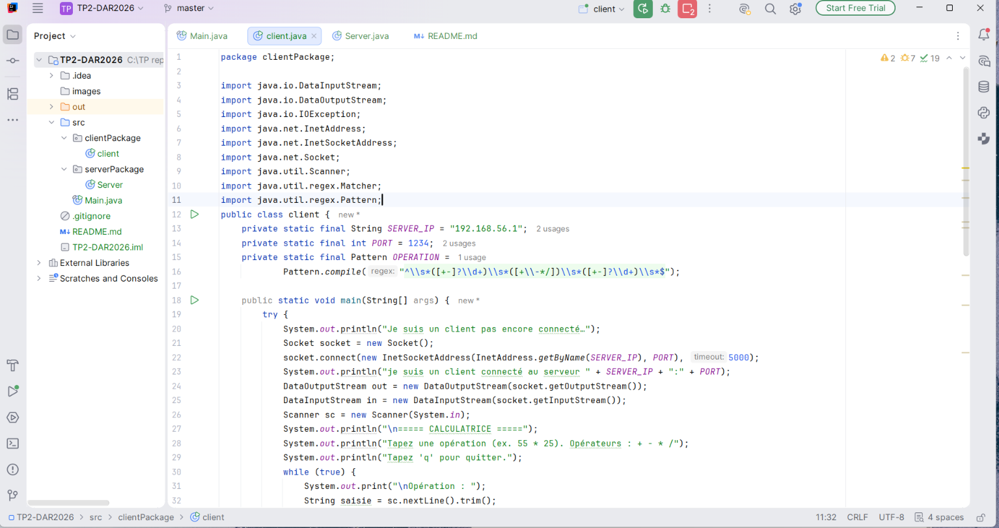
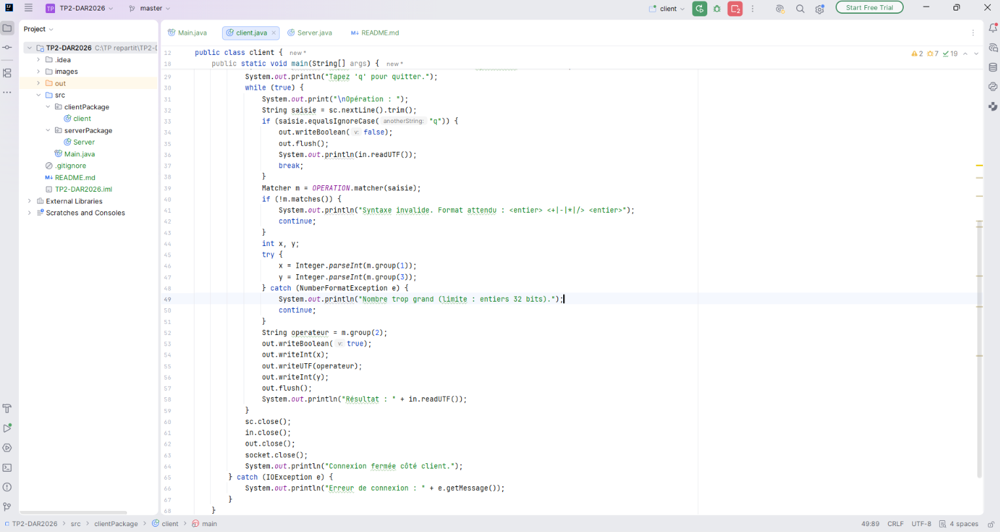
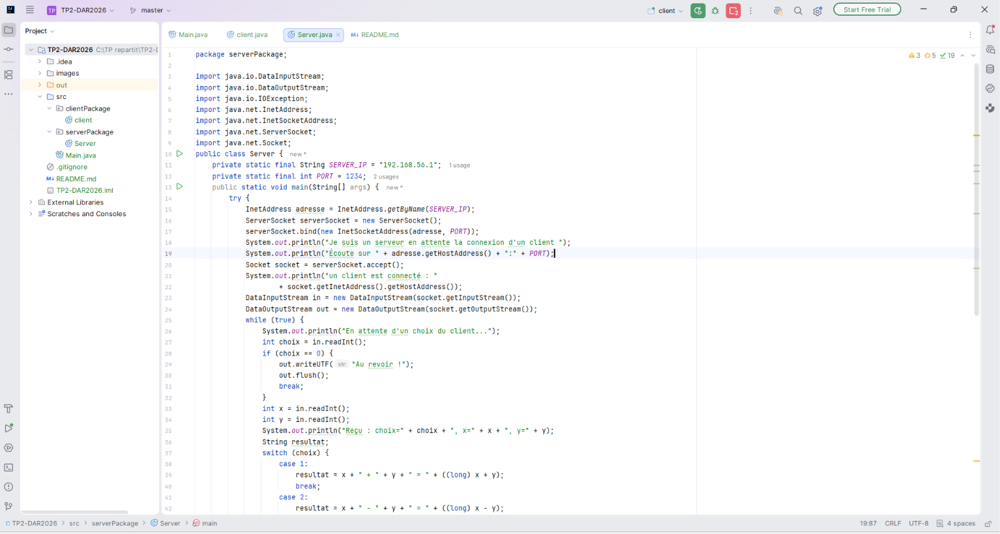
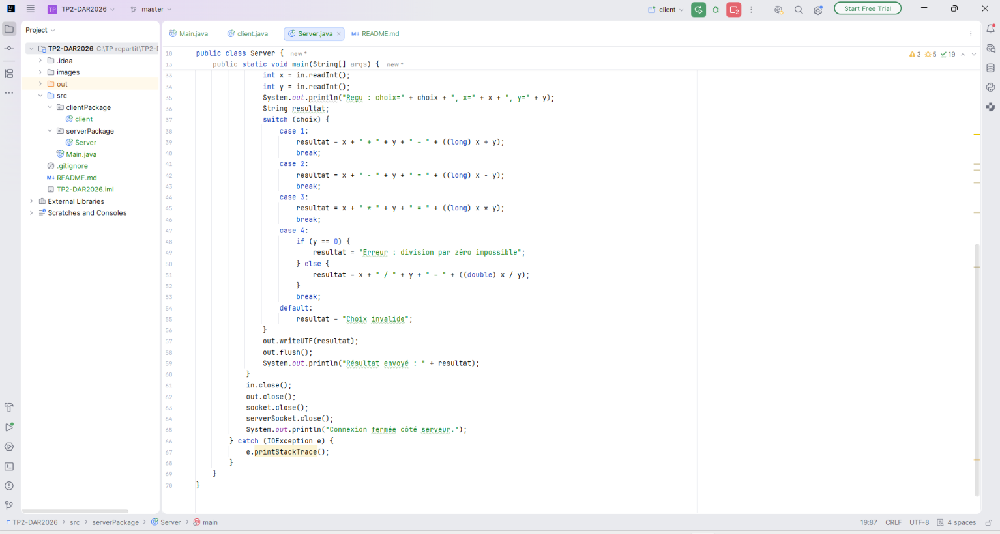
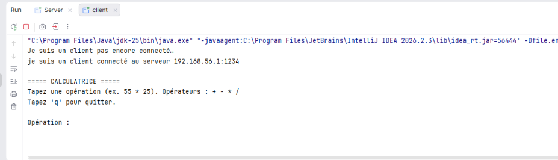
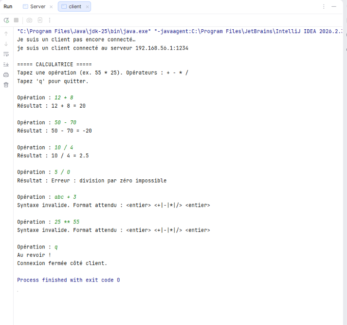
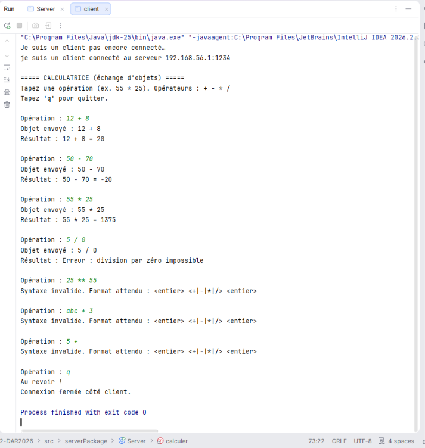
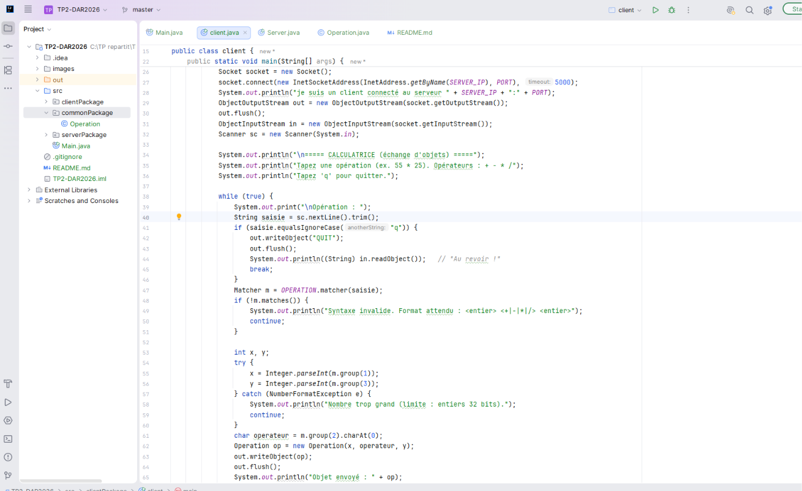
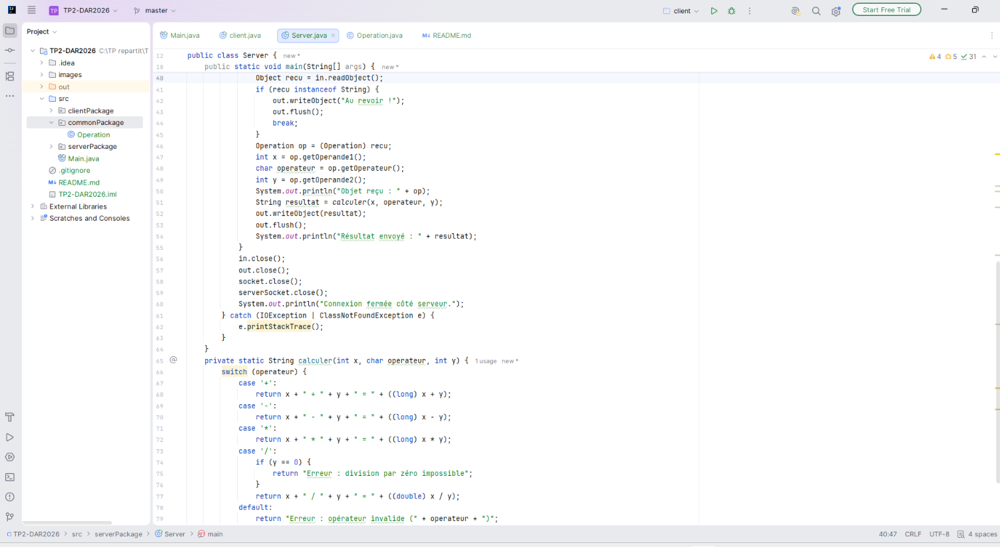

# TP2 – Calculatrice client/serveur

**Étudiant(e)** : à compléter  
**Classe** : LSI3  1TP1
**Matière** : Développement d'applications réparties

## Présentation

Dans ce TP, nous reprenons le client et le serveur du TP1. Cette fois, au lieu d'échanger un seul octet, ils communiquent une opération de calcul et son résultat.

Deux façons d'envoyer l'opération sont présentées :

1. Le client envoie séparément les deux nombres et l'opérateur.
2. Le client regroupe ces informations dans un objet `Operation`, puis l'envoie au serveur.

Dans les deux cas, le serveur effectue le calcul et renvoie le résultat au client.

## Organisation du projet

```
TP2-DAR2026/
├── src/
│   ├── clientPackage/client.java
│   ├── serverPackage/Server.java
│   └── commonPackage/Operation.java
├── images/                # captures d'écran
└── README.md
```

## Technologies

- Java (JDK 8 ou supérieur) et Eclipse
- Sockets TCP (`Socket` et `ServerSocket`)
- Pour la première méthode : `DataInputStream` et `DataOutputStream`
- Pour la seconde : `ObjectInputStream`, `ObjectOutputStream` et `Serializable`

## Fonctionnement

### 1. Envoi des éléments séparément

Le client vérifie d'abord que la saisie contient deux entiers et un opérateur (`+`, `-`, `*` ou `/`). Une saisie comme `25 ** 55` ou `abc + 3` est refusée avant l'envoi.

Si la saisie est correcte, le client envoie les nombres et l'opérateur au serveur avec `writeInt` et `writeUTF`. Le serveur calcule le résultat, puis le renvoie avec `writeUTF`.

Pour terminer, le client envoie `writeBoolean(false)` quand l'utilisateur tape `q`. Le serveur répond alors « Au revoir ! ».

### 2. Envoi d'un objet

La classe `Operation` implémente `Serializable` et contient les deux nombres ainsi que l'opérateur. Le client crée cet objet et l'envoie avec `writeObject`. Le serveur le lit avec `readObject`, effectue le calcul, puis renvoie le résultat sous forme de texte.

Pour quitter dans cette version, le client envoie la chaîne `"QUIT"`. La classe `Operation` doit être disponible dans le package `commonPackage` des deux côtés. Les flux de sortie sont créés et vidés avant les flux d'entrée afin d'éviter que le client et le serveur restent bloqués au démarrage.

## Opérations disponibles

| Opérateur | Opération | Remarque |
|-----------|-----------|----------|
| `+` | Addition | le calcul utilise `long` pour éviter un dépassement |
| `-` | Soustraction | le résultat peut être négatif |
| `*` | Multiplication | le calcul utilise `long` |
| `/` | Division | le résultat peut être décimal ; diviser par zéro affiche une erreur |

Les nombres saisis sont des entiers 32 bits.

## Lancer le programme

1. Vérifier que `SERVER_IP` et `PORT` (1234) ont la même valeur dans `client.java` et `Server.java`.
2. Démarrer `Server` depuis Eclipse (*Run As → Java Application*).
3. Démarrer ensuite `client`.
4. Saisir une opération, par exemple `55 * 25`.
5. Taper `q` pour quitter.

Si le message `Address already in use` apparaît, le port est déjà utilisé. Arrêter l'ancienne exécution avec le bouton carré rouge dans la console Eclipse, puis relancer le serveur.

## Captures d'écran

Les captures du code et des tests réalisés sont dans le dossier `images/`.

### Envoi des éléments séparément

| Capture | Description |
|---------|-------------|
| `code_client1_1` et `code_client1_2` | Les deux parties du code client |
| `code_server1_1` et `code_server1_2` | Les deux parties du code serveur |
| `connexion1` | Connexion du client au serveur |
| `resultat_possible1` | Quelques résultats de calcul |
| `resultats_possible2` | Division par zéro, saisie invalide et fermeture |

### Envoi d'un objet

| Capture | Description |
|---------|-------------|
| `code_client2` | Le client envoie l'objet `Operation` |
| `code_server2` | Le serveur reçoit l'objet et effectue le calcul |











## Exemple d'exécution

```
Opération : 55 * 25
Résultat : 55 * 25 = 1375

Opération : 10 / 4
Résultat : 10 / 4 = 2.5

Opération : 5 / 0
Résultat : Erreur : division par zéro impossible

Opération : 25 ** 55
Syntaxe invalide. Format attendu : <entier> <+|-|*|/> <entier>

Opération : q
Au revoir !
```